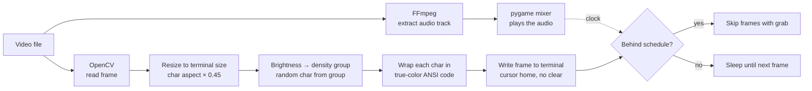

# 🎞️ ASCII Terminal

**Play any video or image as live ASCII art in your terminal, in full color and with sound.**

Pick a file and watch it rendered with text characters, frame by frame, scaled to fit your terminal and kept in sync with the original audio. Resize the window and the picture adapts on the fly.


https://github.com/user-attachments/assets/7c0f95ea-32ad-43af-82a3-1ea07862586e

---

## Highlights

- **Videos and images**: `.mp4`, `.avi`, `.mkv`, `.mov`, `.jpg`, `.jpeg`, `.png`
- **24-bit color**: every character gets the exact color of its pixel through ANSI true-color escape codes
- **Synced sound**: the audio track is extracted with FFmpeg and played alongside the frames
- **Stays in sync** (color editions): if the terminal can't draw fast enough, frames are skipped so the picture never falls behind the sound
- **Fits any window**: the image is scaled and centered to the current terminal size, and re-scaled when you resize
- **"Boiling" texture**: characters are picked at random from groups of similar density, so bright areas shimmer instead of looking flat
- **Zero setup for FFmpeg**: a bundled FFmpeg binary is used, nothing to install separately

## Three editions

| Folder | Colors | Runs on | Start with |
|---|---|---|---|
| `ASCII/` | Grayscale | Windows (also Linux/macOS with `python ascii.py`) | `start.bat` |
| `ASCII renklendirilmiş/` | 24-bit color | Windows (also Linux/macOS with `python ascii.py`) | `kurulum.bat` once, then `start.bat` |
| `ASCII ama linux/` | 24-bit color | Ubuntu / Debian | `bash kurulum.sh` once, then `bash baslat.sh` |


## How it works



**Fitting the picture.** Terminal characters are roughly twice as tall as they are wide, so the height is multiplied by 0.45 to keep the original proportions. The frame is then fitted inside the terminal (width or height, whichever runs out first) and centered with padding.

**From pixels to characters.** Each pixel's perceived brightness is computed with the standard luminance formula `0.299 R + 0.587 G + 0.114 B` and mapped to one of seven groups, from empty space to dense symbols like `#`, `@` and `0`. A character is picked at random from its group on every frame, which gives the moving, shimmering look.

**Color.** In the color editions every character is prefixed with `ESC[38;2;R;G;Bm`, the ANSI escape for a 24-bit foreground color, and each line ends with a reset so the padding stays clean.

**Smooth output.** The cursor is hidden and moved to the top-left before each frame instead of clearing the screen, which avoids flicker. The screen is fully cleared only when the terminal size changes.

**Audio sync.** Before playback, FFmpeg (from `imageio-ffmpeg`) writes the audio to a temporary MP3 that `pygame.mixer` plays. The color editions schedule frames against a fixed clock started with the audio: frame *n* should appear at *n / fps* seconds. If drawing falls behind, frames are skipped with OpenCV's `grab()`, which advances without decoding, until the picture catches up. The temporary audio file is deleted when playback ends.

## Getting started

### Windows

1. Install Python 3 and tick **Add Python to PATH** during setup.
2. In `ASCII renklendirilmiş/`, run `kurulum.bat` once to install the libraries.
3. Put your videos or images into a folder named `Medya` next to the script (it's created for you on the first run).
4. Run `start.bat` and choose a file from the list.

Use **Windows Terminal** for the color editions; the classic console window may not show 24-bit color.

### Linux (Ubuntu / Debian)

```bash
cd "ASCII ama linux"
bash kurulum.sh      # checks for Python 3.8+, creates a virtual environment, installs the libraries
bash baslat.sh       # put your files into Medya/ first
```

### Manual setup (any OS)

```bash
pip install opencv-python pygame imageio-ffmpeg numpy
python ascii.py
```

Press `Ctrl + C` to stop playback.

## Tips

- Zoom the terminal out (`Ctrl` + `-`) for more characters and a sharper picture.
- High-contrast videos with clear shapes look best.
- Media files are not included in the repository; use your own videos and images.

## Roadmap

- [ ] One cross-platform script with a `--mono` option instead of three folders
- [ ] Vectorize the frame conversion with NumPy for higher frame rates in large terminals
- [ ] Pause, seek and volume keys during playback
- [ ] A `requirements.txt` and a single launcher
